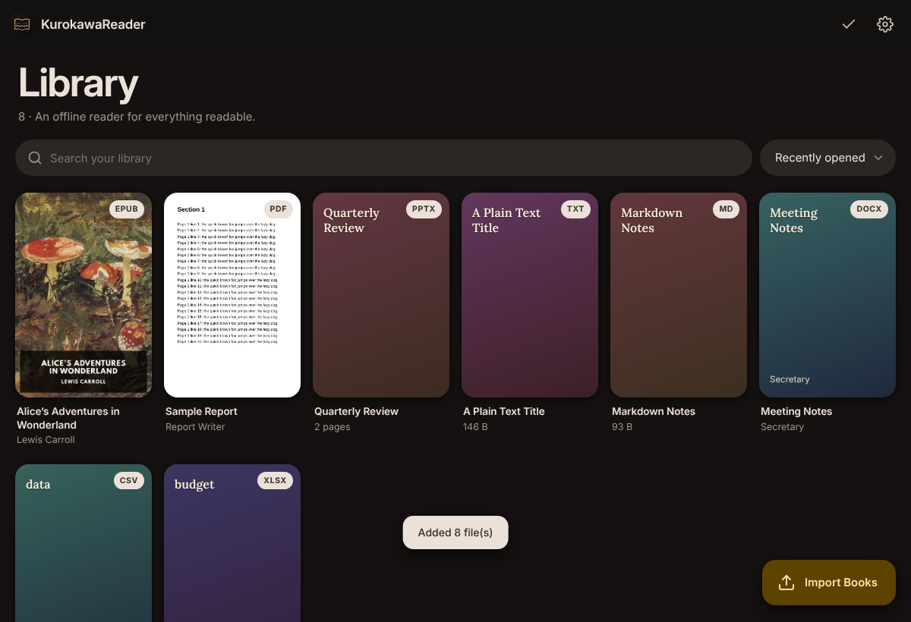
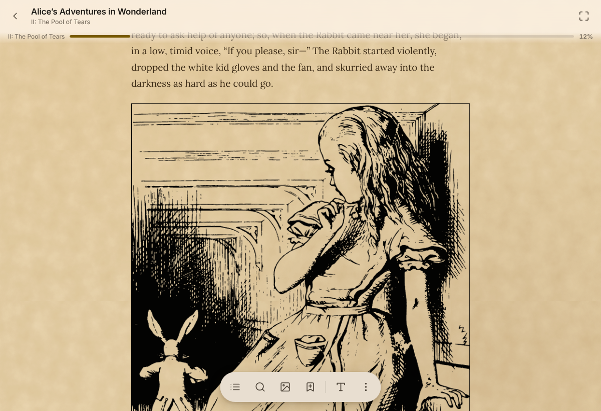

<div dir="rtl">

[English](README.md)

EPUB · PDF · Word · Excel · PowerPoint · نصوص وMarkdown · HTML · FictionBook · OpenDocument · قصص مصوّرة · صور — مكتبة واحدة تعمل دون اتّصال.

**التنزيل:** [الإصدارات](../../releases) — أندرويد · ويندوز · ماك · لينكس · iOS (تثبيت جانبيّ) · [ملاحظات التثبيت](docs/INSTALL.md)

<p align="center">
  
  
</p>

- قراءة فصلًا فصلًا أو بتمرير متّصل، علامات مرجعيّة، تظليل مع تعليقات، بحث، قراءة بصوت عالٍ، فوريغانا، إيماءات، اختصارات قابلة للتخصيص
- ٢٧ سمة، ألوان مخصّصة، خامات وصور خلفيّة، خطوطك الخاصّة
- لقطات للنصّ المحدّد، ترجمة مدمجة / بتطبيقات الجهاز / بالذكاء الاصطناعيّ، تصدير PNG
- مزامنة سحابيّة (Dropbox · WebDAV · مجلّد Drive)، نسخ احتياطيّة محمولة، تحديثات من داخل التطبيق على كلّ المنصّات

</div>

```bash
npm install && npm run build            # الويب → dist/
npm run android:prepare                 # أندرويد · npm run ios:prepare لـ Xcode
cd desktop && npm install && npm run dist:win   # سطح المكتب (win / mac / linux)
```
