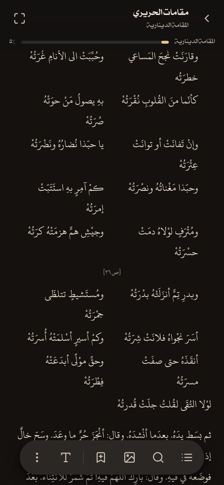
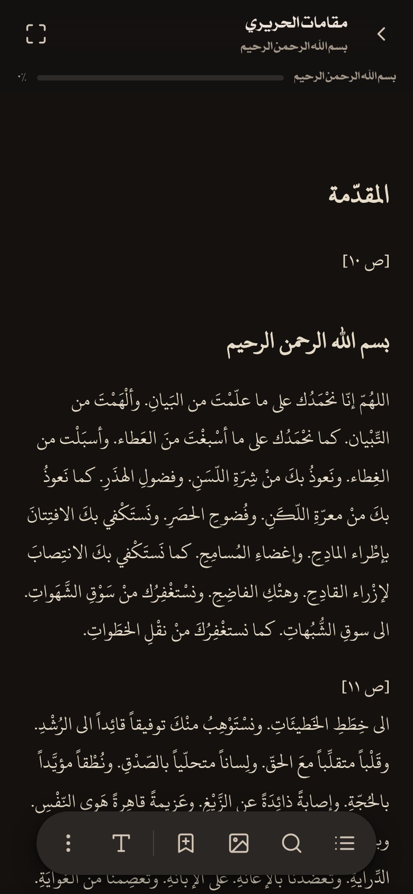
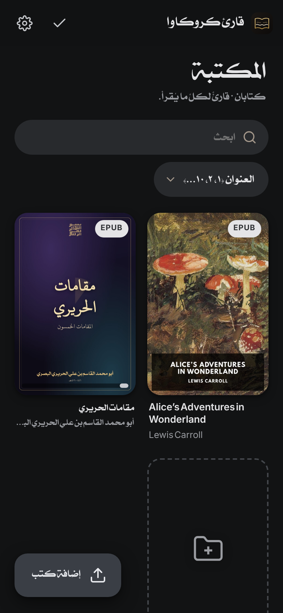

# قارئ كروكاوا · KurokawaReader

**A reader for everything readable.** EPUB, PDF, Word, Excel, PowerPoint, text, Markdown, HTML, FictionBook, OpenDocument, comics and images — in one library that lives on your device and works with no connection, with Arabic typography treated as a first-class citizen.

Downloads for **Android (APK)**, **Windows (EXE)** and **iOS (IPA for AltStore/SideStore)** are on the [Releases](../../releases) page; install notes are in [docs/INSTALL.md](docs/INSTALL.md).

<p align="center">
  
  
</p>
<p align="center">
  
  
  
</p>

## Features

**Library**
- Import anything readable; drag files in, pick them, or open them from another app — the reader appears in Android's and iOS's "Open with" sheets and registers the file types on Windows.
- **Scan the device**: pick a folder (or the whole storage) and every readable file in it is listed with type filters (EPUB, PDF, Word, …); import a selection or all of them into the library, an existing folder or a new one.
- **Folders**: create folders, drag books onto them, or select several and *Move to folder*. Importing while inside a folder files the books there. Folder chips and **format filters** (several at once) sit above the shelf.
- Covers, progress bars, long-press selection, sort by last opened / added / title / author, search.
- Two starter books so the shelf is never empty (below).

**Reading**
- **Read together** — open several books in one continuous scroll; book 1 flows into book 2, each with its own contents, images, bookmarks and progress.
- Own EPUB engine: nested contents, internal links, footnotes, SVG, publisher fonts; publisher styles are optional.
- **Themes**: Grey (default), Dark, Black, Slate, Night, Olive, Amber, Forest, Plum, Ink, Sepia, Paper, Sand, Mint paper, Rose paper, Light, and **Custom** with your own page and text colours. One-tap presets: Night, Candlelight, Manuscript, Daylight, E-ink.
- **Backgrounds**: paper / linen / parchment / dots textures with a strength control; your own background picture with opacity and blur.
- **Comfort**: warmth (night) filter and page dimming, independent of the theme.
- **Type & layout**: Lora / Inter / system or **your own fonts** (add TTF/OTF/WOFF files from the device or fetch one from a URL; assign them to Latin or Arabic), Uthman TN1 / Sultan / Naskh for Arabic, size, line height, paragraph spacing, text width, margins, alignment, word and letter spacing, hyphenation.
- Contents, bookmarks, highlights in five colours with notes, in-book search that ignores Arabic diacritics and letter variants, auto-scroll, read-aloud, immersive mode, full screen, screen-orientation lock.
- **Book information**: file facts, chapter and position, reading time, reading speed, a per-day history, word and character counts, and minutes left in the chapter and the book.
- **Images**: a gallery of every picture in the open books with a lightbox, *show in text*, save and share. Black-on-transparent line art is inverted on dark pages.

**Selection tools** — select text to get a colour row for highlighting plus *Copy · Search · Define · Translate · Note · Text as image (صوِّر النص) · More*. Text snapshots are plain by default — the passage on the page colour, like a screenshot — or a card with title and author; they save to *Pictures/Screenshots* (folder adjustable) or go straight to the share sheet. Translation can use the built-in service or a translator app on the device (a setting). "More" offers *Translate with…* (hands the text to Google Translate or any other app on the device), share, read aloud, web search and Wikipedia. Define and Translate use the web when it is available and say so when it isn't.

**PDF** — lazily rendered pages with selectable text, a **page slider**, **go to page**, zoom and fit-width, outline, full-text search with highlighting, a **pages grid** (thumbnails you tap to jump), **save page as PNG** or share it, optional dark rendering, bookmarks. Documents open instantly: pages are laid out from the first page's size and corrected in the background.

**Office & text** — DOCX (headings, lists, tables, images, footnotes), XLSX (sheets, dates, formulas) and CSV, PPTX (titles, bullets, pictures, notes), TXT with legacy Arabic/Latin encoding detection, Markdown, HTML, FB2, ODT, CBZ, images.

**Interface** — Material 3 Expressive: tonal surfaces, floating toolbar, extended FAB, connected button groups, expressive sliders and switches, springy shape changes. Light / dark / system / follow-the-page modes and six accent colours (aqua by default) or a custom one. English and eloquent Arabic (RTL).

**Arabic** — Lora for Latin, Uthman TN1 for Arabic, Inter and Sultan for the interface, falling through per glyph so mixed text renders each script in its own face; every paragraph gets its own direction; shaping features are forced on and letter-spacing never touches Arabic, so لا and the marks render as designed.

## The starter books

**مقامات الحريري** — the fifty *maqāmāt* of Abū Muḥammad al-Qāsim ibn ʿAlī al-Ḥarīrī of Basra (446–516 AH), complete with his preface and epilogue. Each maqāma is a short episode told by al-Ḥārith ibn Hammām, who keeps running into the eloquent rogue Abū Zayd al-Sarūjī in a different city — Sanaa, Baghdad, Damascus, Alexandria, Mecca — where Abū Zayd talks his way to a reward through sermons, riddles, legal disputes and poems, and vanishes before the trick is noticed. The book is the showpiece of Arabic rhymed prose (*sajʿ*): every episode is built from word-play, puzzles, double readings and verses, and it was studied for centuries as a model of the language. The text is the Shamela edition (book 26585), laid out by maqāma with verses in paired hemistichs.

**Alice's Adventures in Wonderland** — Lewis Carroll's 1865 story of a girl who follows a hurried White Rabbit down a hole into a world of shrinking potions and growing cakes, a Caterpillar on a mushroom, a grinning Cheshire Cat, a tea party that never ends, a croquet game played with flamingos, and a Queen of Hearts whose answer to everything is "Off with their heads!" — until a nonsensical trial sends Alice back to the riverbank. The edition is Standard Ebooks' with all forty-two of John Tenniel's original illustrations.

## Run from source

```bash
npm install
npm run dev        # http://localhost:5173
npm run build      # dist/ with the offline service worker
npm run android:prepare && cd android && ./gradlew assembleRelease   # APKs (needs Android SDK)
npm run ios:prepare                                                 # then open ios/App in Xcode
cd desktop && npm install && npm run dist:win                       # Windows EXE
```

Tagging `vX.Y.Z` runs the release workflow, which builds the web bundle, the ABI-split APKs, the unsigned IPA and the Windows installer/portable EXE and attaches them to a GitHub Release.
