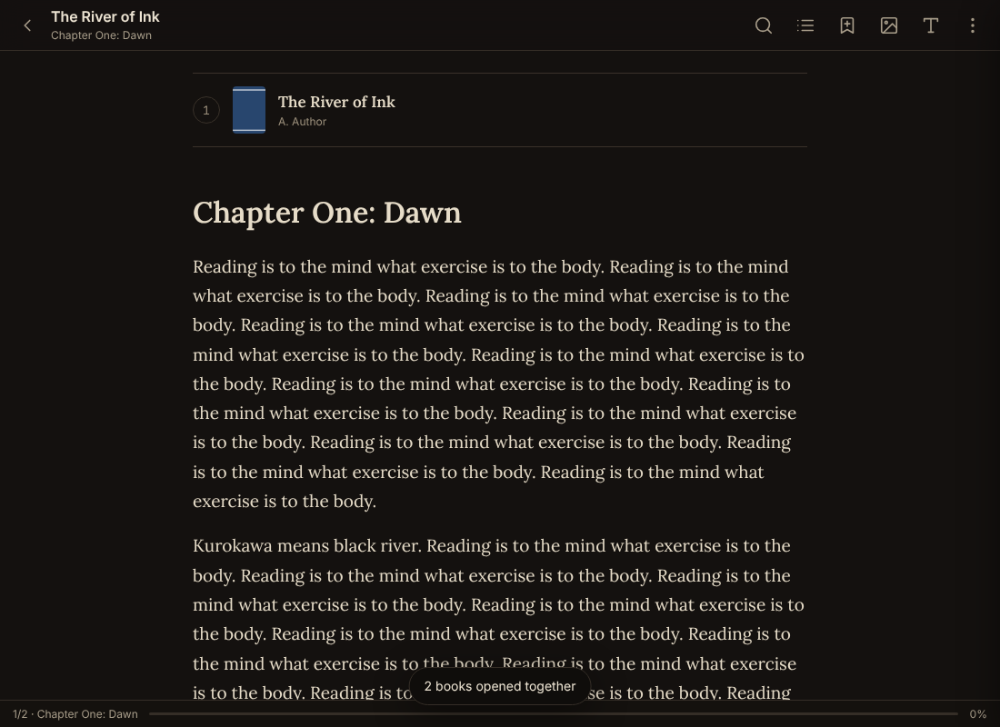

# KurokawaReader · قارئ كوروكاوا

**An offline reader for everything readable — with Arabic typography at its heart.**

KurokawaReader opens EPUB, PDF, DOCX, XLSX/CSV, PPTX, TXT, Markdown, HTML, FB2, ODT, CBZ and images, keeps them in a local library, and lets you read **several books in one continuous scroll**. It is a progressive web app: install it once and it works with no connection at all. Nothing you import ever leaves your device.

<p align="center">
  
  
</p>

## Features

**Reading**
- Own EPUB engine — every chapter is flowed into one column, so the reader's typography, theme and tools apply everywhere. Internal links, footnotes, SVG images and publisher fonts work; publisher styles are off by default and can be switched on.
- **Read together**: select several books in the library and open them in one session. You scroll from the end of book 1 straight into book 2, with each book's images, table of contents and progress kept separately.
- Dark theme by default for EPUBs, plus Black, Sepia, Paper and Light.
- **Visual Options**: Latin font, Arabic font, size, line height, paragraph spacing, text width, margins, alignment, word/letter spacing, hyphenation, image dimming, publisher styles.
- Table of contents (nested), bookmarks, highlights, in-book search (diacritic- and case-insensitive, with Arabic letter-form folding), reading progress, resume where you left off.
- Auto-scroll with a speed control, read-aloud (device voices), immersive mode, full screen, keyboard shortcuts.
- **Images** gallery: every picture from the open books, with a lightbox and "show in text".

**Selection tools** — select any text to get *Copy · Search · Define · Translate · Highlight · Speak*. The reader is offline; Define and Translate are the only features that use the network, and they say so when there is none.

**PDF**: lazily rendered pages with a selectable text layer, **page slider**, **go to page**, previous/next, zoom and fit-width, outline, full-text **page search** with hit highlighting, optional dark rendering of pages, bookmarks.

**Office & text**: DOCX (headings, lists, tables, images, footnotes), XLSX (sheets, dates, bold, formulas, chunked rows) and CSV, PPTX (titles, bullets, pictures, tables, speaker notes), TXT with legacy-encoding detection (windows‑1256 Arabic, windows‑1252), Markdown, HTML, FB2, ODT, CBZ comics and single images.

**Arabic**
- Interface in English or Arabic (right-to-left layout). The Arabic strings are written in sound, idiomatic Arabic rather than word-for-word translation.
- Fonts: **Lora** for Latin text and **Uthman TN1** for Arabic text; **Inter** and **Sultan** for the interface. Fonts fall through per glyph, so mixed-language books render each script in its own face, and each paragraph gets its own direction automatically.

## Formats

| Format | Notes |
| --- | --- |
| EPUB 2/3 | Own engine, nav/NCX TOC, cover, images, SVG, internal links, publisher CSS (optional) |
| PDF | pdf.js; slider, go-to, search, outline, text selection, dark pages |
| DOCX | Headings, lists, runs, tables, images, footnotes, RTL paragraphs |
| XLSX / CSV / TSV | Multiple sheets, shared strings, dates, bold, formula fallback |
| PPTX | Slide order, titles, bullets, pictures, tables, notes |
| TXT / MD / HTML | Encoding detection, Markdown via marked, sanitised HTML |
| FB2 / ODT | Sections, images, notes |
| CBZ / images | Page stack with gallery |

Not yet: MOBI/AZW3, CBR (RAR), legacy `.doc`/`.xls`/`.ppt` binaries, RTF.

## Run it

```bash
npm install
npm run dev      # http://localhost:5173 with rebuild on change
npm run build    # production build in dist/ (includes the offline service worker)
npm run typecheck
```

Serve `dist/` from any static host over HTTPS (or localhost) and the app installs as a PWA. On Android, "Add to Home screen" gives you a standalone app with file handling for the supported types.

### Android / iOS wrapper

The app is plain static files, so it wraps cleanly with Capacitor if you want a store build:

```bash
npm i -D @capacitor/core @capacitor/cli @capacitor/android
npx cap init KurokawaReader com.kurokawa.reader --web-dir dist
npx cap add android
npm run build && npx cap sync && npx cap open android
```

## Project layout

```
public/            index.html, manifest, icons
scripts/build.mjs  esbuild bundle + static copy + generated service worker
src/
  formats/         epub.ts (own engine), pdf.ts, docx.ts, sheet.ts, pptx.ts, text.ts, misc.ts (fb2/odt/cbz/image)
  views/           library.ts, reader.ts (flow + PDF), gallery.ts, settings.ts
  ui/              selection toolbar, define/translate, options panel, side panel, DOM helpers
  i18n/            en.ts, ar.ts
  styles/          fonts.css, base.css, reader.css
tests/smoke.cjs    headless end-to-end run over generated fixtures (needs playwright)
scripts/make-fixtures.py  builds sample EPUB/PDF/DOCX/XLSX/PPTX/TXT/MD/CSV files
```

## Keyboard

`J`/`K` or arrows scroll · `Space` page down · `[` `]` previous / next book · `/` search · `B` bookmark · `G` images · `V` visual options · `C` contents · `A` auto-scroll · `F` full screen · `Esc` close. PDF: `←`/`→` pages, `+`/`−` zoom, `G` go to page.

## Licenses

Code: MIT. Fonts: Lora, Inter and Noto Naskh Arabic under the SIL Open Font License (see `LICENSES/`); Uthman TN1 (KFGQPC) and Sultan Medium are redistributed as supplied by the user — see `LICENSES/Sultan-NOTE.txt`. pdf.js is Apache‑2.0; JSZip, DOMPurify and marked are MIT/Apache.

---

## بالعربية

**قارئ كوروكاوا** قارئٌ يعمل دون شبكةٍ لكلِّ ما يُقرأ: كتب EPUB وملفات PDF ومستندات Word وجداول Excel وعروض PowerPoint والنصوص وغيرها، تُحفظ في مكتبةٍ على جهازك ولا تغادره.

- **القراءة معًا**: حدِّد كتبًا عدّة في المكتبة وافتحها في جلسةٍ واحدة؛ تمرّ من آخر الكتاب الأوّل إلى أوّل الثاني في تمريرٍ متّصل، ولكلِّ كتابٍ صورُه وفهرسُه وموضعُ قراءته.
- **المظهر الداكن** أصلٌ لكتب EPUB، ومعه الأسود والبُنّيّ والورقيّ والفاتح، و**خيارات العرض** للخطّ والحجم وتباعد الأسطر وعرض النص والهوامش والمحاذاة.
- **أدوات التحديد**: نسخ، بحث، المعنى، ترجمة، تمييز، نطق.
- **PDF**: شريط تمرير للصفحات، الانتقال إلى صفحة، البحث في الصفحات، الفهرس، تكبير وتصغير، عرض الصفحات داكنةً.
- **الخطوط**: Lora للنص اللاتيني، وعثمان طه للنص العربي، وInter وسلطان للواجهة؛ وتُضبط جهة كلِّ فقرةٍ تلقائيًّا.
- الواجهة العربية مكتوبةٌ بعربيةٍ فصيحةٍ سليمة، لا بالترجمة الحرفية.
