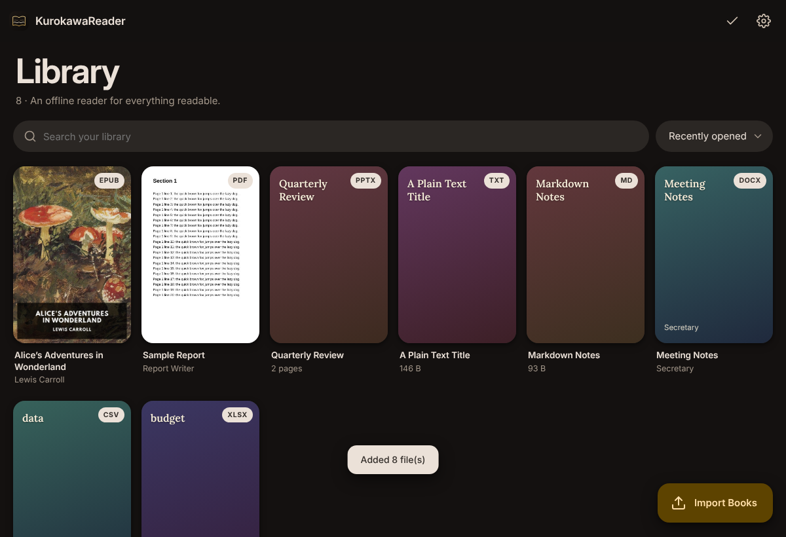
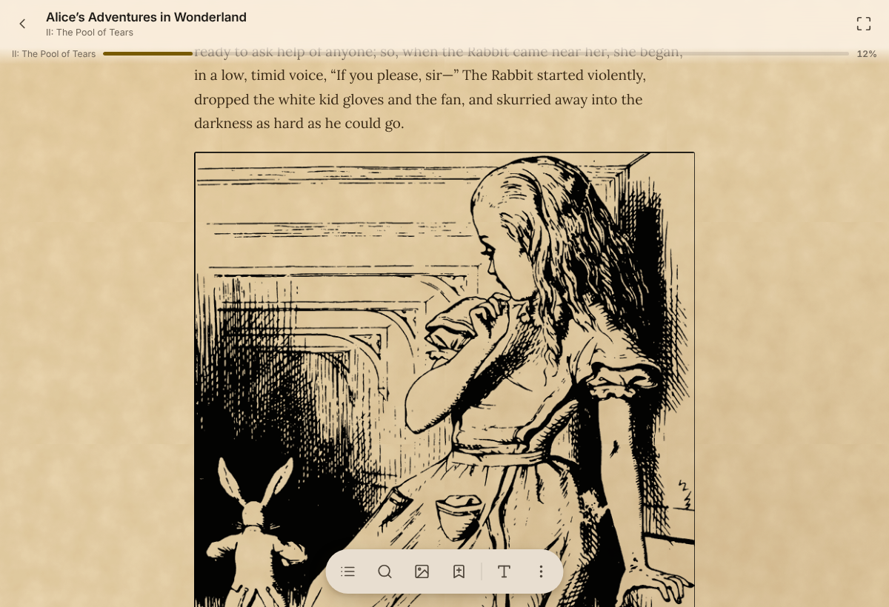

# Kurokawa Reader

Part of the [Kurokawa apps](../../README.md), beside **Kurokawa Tools** (downloads, a file browser, a video player and system monitors).

EPUB · PDF · Word · Excel · PowerPoint · text & Markdown · HTML · FictionBook · OpenDocument · comics · images — one offline library.

**Download:** [Releases](../../releases) — Android · Windows · macOS · Linux · iOS (web app, TrollStore, AltStore/SideStore source) · **[Web app](https://yoru72.github.io/KurokawaReader/)** (install from the browser, no signing) · [install notes](docs/INSTALL.md)

**Computer (from 0.62.0): a new, far smaller app** — Windows `KurokawaReader-<v>-windows-x64.exe` (about 13 MB, installs in seconds, no administrator prompt; also a portable zip), macOS `…-macos-universal.DMG`, Linux `…-linux-x64.appimage` or `.deb` (about 11 MB). The computer app is this one build; the previous program (an old engine, about 82 MB) is no longer built or offered. A copy of it still updates itself to the new app, and your whole library comes over; nothing is deleted.

<p align="center">
  
  
</p>

- **Library:** folders, series and tags, pins at the head of each shelf (tags too), covers, search, deleting a book's file from the device as well, and Undo / Redo throughout
- **Reading:** chapters or continuous scrolling, bookmarks, highlights with notes, search, gestures, rebindable shortcuts, and text spacing in your hands — Smart justify, hyphenation, word and letter spacing, paragraph indent
- **Themes:** 27 themes, custom colours, textures and background pictures, your own fonts; interface styles for the app itself (Classic by default, Paper & Ink, Midnight Stacks, Reading Room, Obsidian and the Frosted Glass trio), customised and saved as your own
- **PDF:** sharp, quick zoom, a page grid, and PDF → Word keeping each page's layout (tables, formulas, the PDF's own fonts)
- **Converter:** books to EPUB, Word, PDF, HTML, Markdown, text, FB2, ODT, RTF and comics, working in the background
- **Read-aloud**, text snapshots and PNG export
- **Sync and backup:** cloud sync (Dropbox · WebDAV · a Drive folder), portable backups, in-app updates on every platform
- **Catalogues and add-ons you add yourself:** online catalogues (OPDS), web folders and extension repositories, browsed and fetched from inside the app, with checks for new chapters

```bash
npm install && npm run build            # web → dist/
npm run android:prepare                 # Android · npm run ios:prepare for Xcode
cd desktop-tauri && npx @tauri-apps/cli@^2 icon ../desktop/icon.png && npx @tauri-apps/cli@^2 build   # computer app (Windows / macOS / Linux)
```
