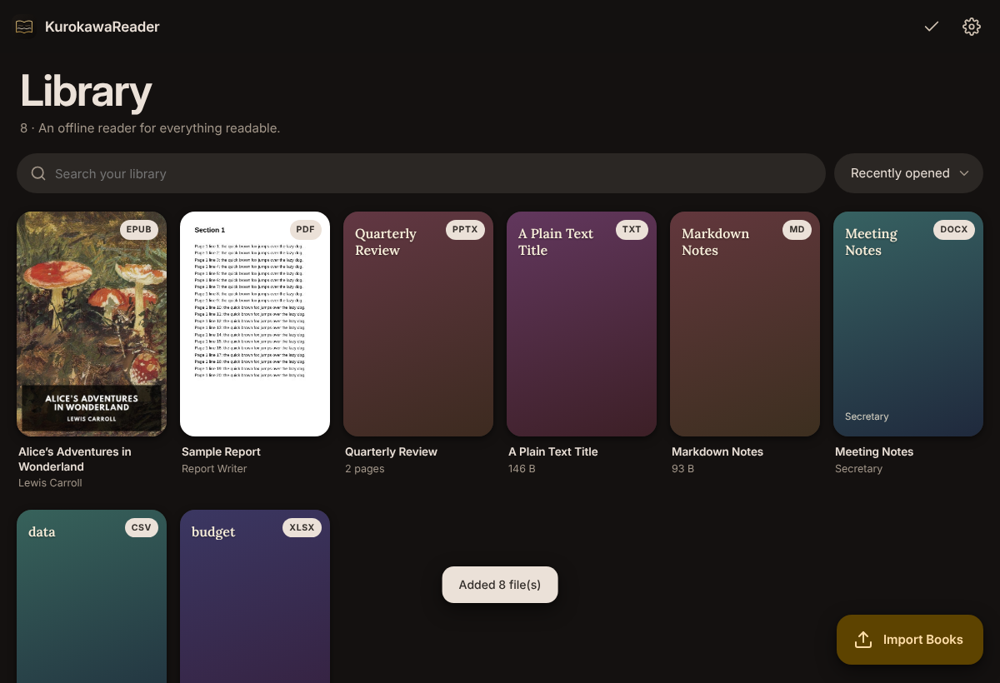
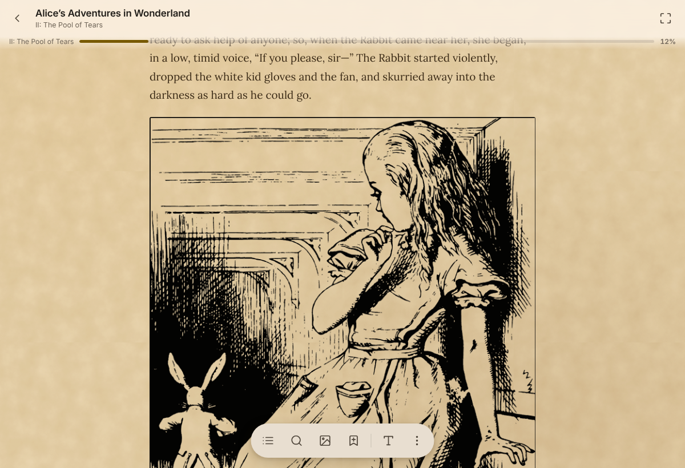

[العربية](README.ar.md) · part of the [Kurokawa apps](../../README.md), beside **Kurokawa Tools** (downloads, torrents, streaming, a player)

EPUB · PDF · Word · Excel · PowerPoint · text & Markdown · HTML · FictionBook · OpenDocument · comics · images — one offline library.

**Download:** [Releases](../../releases) — Android · Windows · macOS · Linux · iOS (web app, TrollStore, AltStore/SideStore source) · **[Web app](https://yoru72.github.io/KurokawaReader/)** (install from the browser, no signing) · [install notes](docs/INSTALL.md)

**Computer (from 0.62.0): a new, far smaller app** — Windows `KurokawaReader-<v>-windows-x64.exe` (about 13 MB, installs in seconds, no administrator prompt; also a portable zip), macOS `…-macos-universal.DMG`, Linux `…-linux-x64.appimage` or `.deb` (about 11 MB). The previous build (old engine, about 82 MB) stays on the release page for two versions as a fallback. Updating from the previous version brings your whole library over; nothing is deleted.

<p align="center">
  
  
</p>

- Chapters or continuous scrolling, bookmarks, highlights with notes, search, read-aloud, furigana, gestures, rebindable shortcuts
- 27 themes, custom colours, textures and background pictures, your own fonts
- Snapshots of selected text, built-in / device / AI translation, PNG export
- A converter: PDF → Word keeping each page's layout (Arabic and CJK, tables, formulas, the PDF's own fonts); books to EPUB, Word, PDF (printed by the system on phones and the desktop: real text), HTML, Markdown, text, FB2, ODT, RTF and comics — going on in the background
- Cloud sync (Dropbox · WebDAV · a Drive folder), portable backups, in-app updates on every platform
- Online catalogs (OPDS): Project Gutenberg and other free libraries, or your own Calibre-Web, Kavita, Komga or Nextcloud shelf, browsed and fetched from inside the app
- Sources, browsed the way Mihon browses its extensions: the Internet Archive; the Shamela library of Arabic works, read page by page from the site or fetched whole, with the site's own full-text search (no account) and وصلة الشاملة as an option; web folders (h5ai, Apache, nginx…) as shelves of series, each with its first volume's cover; extension repositories you add yourself — LNReader plugins and Mangayomi novel extensions run inside the app (sandboxed) — novels read chapter by chapter online or fetched for offline, with new-chapter and extension-update checks, a bell, a mark on the book and a notification; browser checks (Cloudflare) passed by the app itself — and a site that turns away anything but a browser reached through the app's own browser, which makes the requests itself (Android, iOS and the desktop), the reader asked to confirm they're human only when the site insists

```bash
npm install && npm run build            # web → dist/
npm run android:prepare                 # Android · npm run ios:prepare for Xcode
cd desktop && npm install && npm run dist:win   # desktop (win / mac / linux)
```
